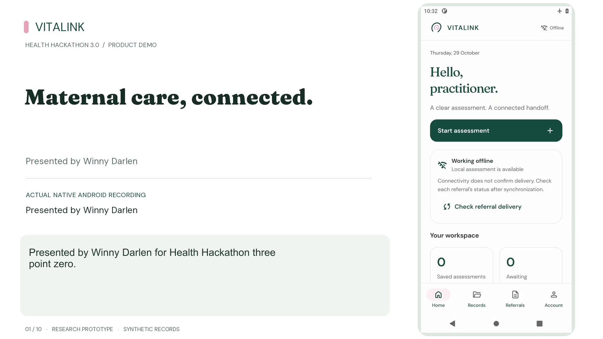
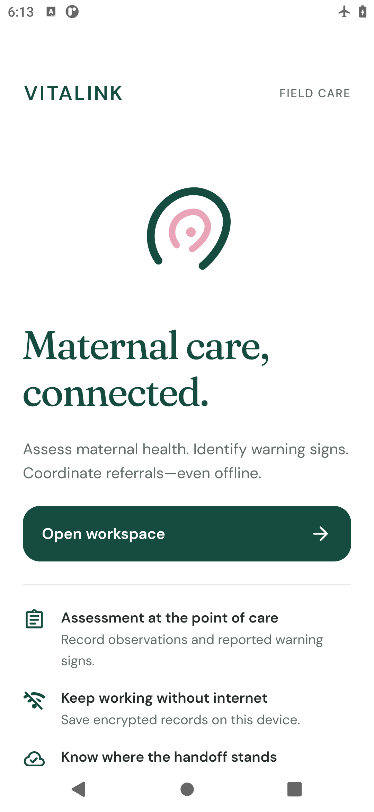
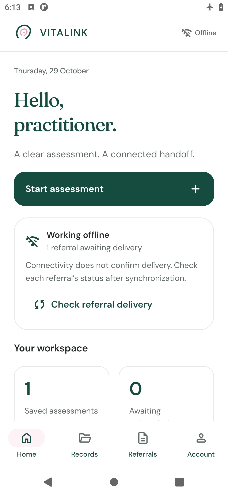
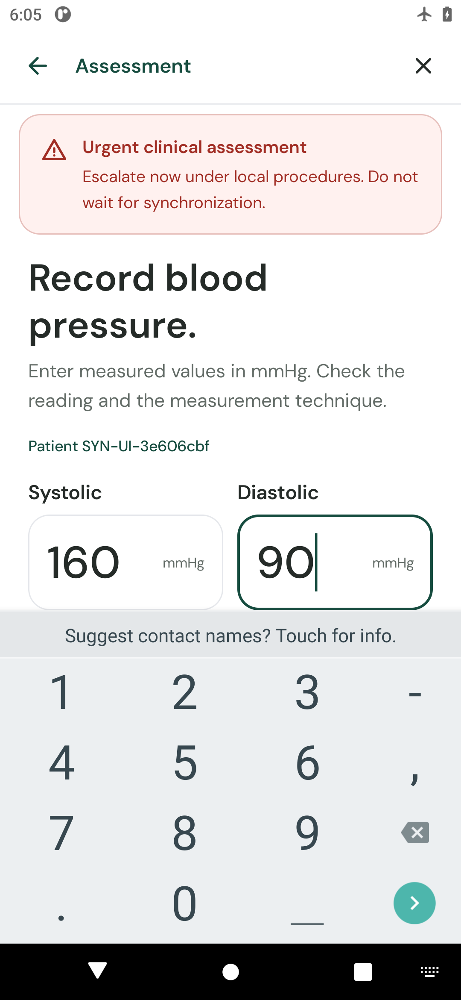
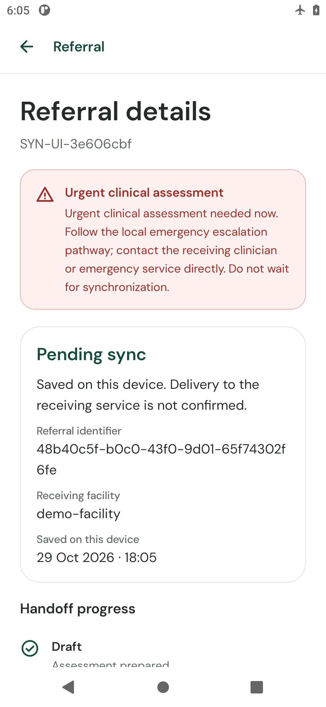
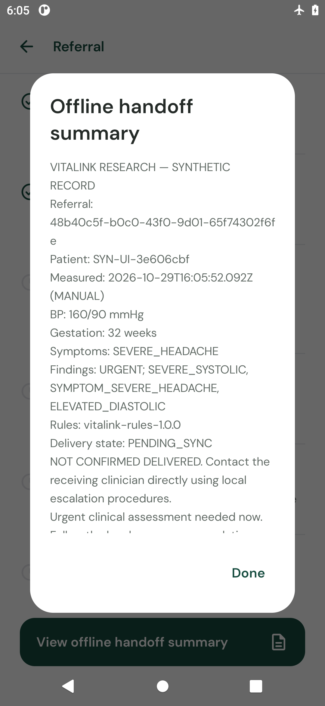
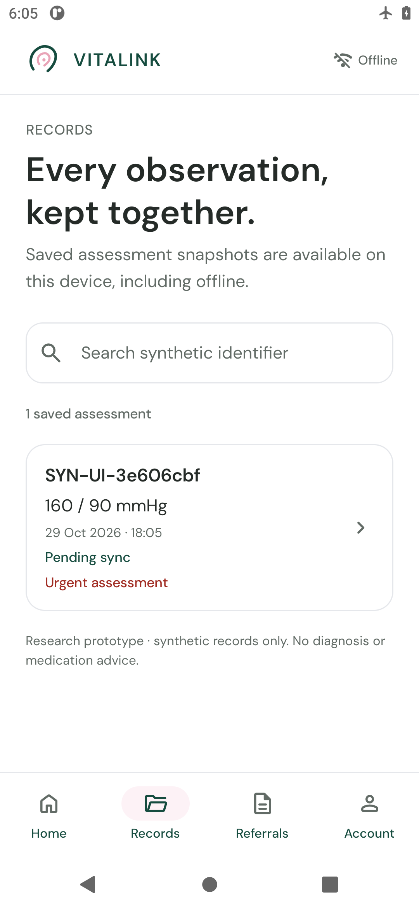
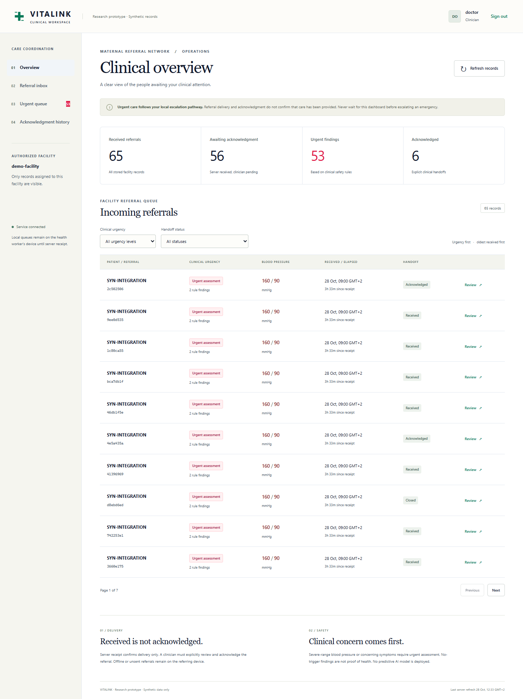
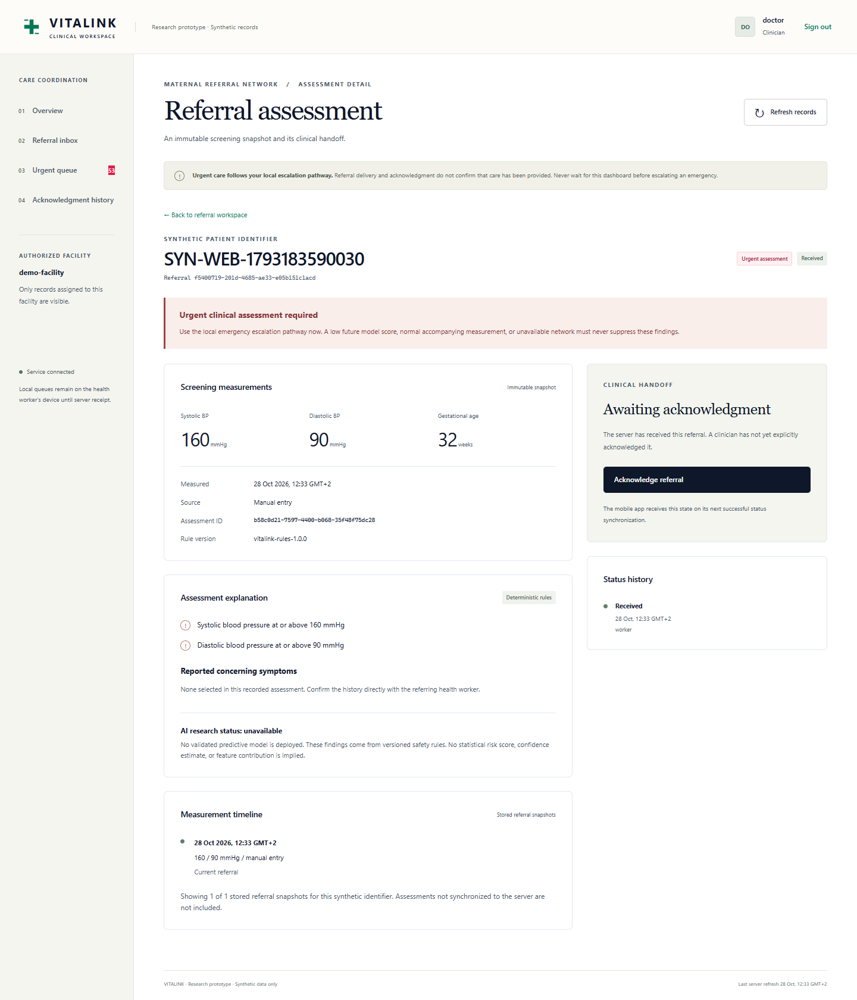
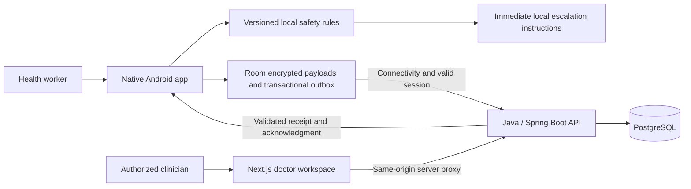

<p align="center"></p>

<h1 align="center">VITALINK</h1>
<p align="center"><strong>Maternal care, connected.</strong></p>
<p align="center">Offline maternal assessment, deterministic safety rules and traceable referral coordination.</p>
<p align="center">Health Hackathon 3.0 · Presented by <strong>Winny Darlen</strong></p>

<p align="center"><a href="#demo">Demo</a> · <a href="#screenshots">Screenshots</a> · <a href="#quick-start">Run locally</a> · <a href="#verification">Test evidence</a> · <a href="#documentation">Documentation</a></p>

> **Research prototype — synthetic records only.** VITALINK is not a validated medical device. It provides no diagnosis, medication advice or validated predictive risk score. Clinical review, governance approval and field validation are required before patient use.

## What VITALINK does

VITALINK helps a health worker record maternal observations without internet access and follow a referral through to explicit clinician acknowledgment. The Android app, Java API and doctor workspace share one stable referral identifier.

1. Record a synthetic patient identifier, blood pressure, gestational age and reported warning signs.
2. Run versioned clinical safety rules entirely on the device.
3. Commit an immutable assessment, referral and outbox entry to local storage.
4. Recover committed records after app restart and retry delivery when connectivity permits.
5. Let the receiving clinician inspect the stored assessment and explicitly acknowledge it.
6. Refresh Android to retrieve the confirmed acknowledgment and its actor/timestamp.

Urgent assessment instructions remain available immediately. **Never wait for synchronization to follow the local escalation pathway.**

## Demo

**English narration and captions · Winny Darlen**

[Download/watch the MP4 demonstration](submission/video/VITALINK_Demo_Winny_Darlen.mp4) · [Captions](submission/video/VITALINK_Demo_Winny_Darlen.srt) · [Video details and recording evidence](submission/video/README.md)

[](submission/video/VITALINK_Demo_Winny_Darlen.mp4)

The demonstration uses actual native Android and local browser recordings with synthetic records. It covers offline assessment, safety warnings, durable referral creation, synchronization, doctor review, acknowledgment and mobile status retrieval. Narration is computer-generated; the screen recordings show the implemented prototype. See the video report for exact runtime, format and recording evidence. No public application deployment is implied by this repository.

## Screenshots

These are actual application screenshots using synthetic demonstration records. Click an image to view its full resolution. Gallery captures can contain different test fixtures; counts are not patient outcomes.

<table>
  <tr>
    <th>Welcome</th><th>Offline workspace</th><th>Urgent BP assessment</th>
  </tr>
  <tr>
    <td><a href="submission/devpost-media/01-welcome.png"></a></td>
    <td><a href="submission/devpost-media/02-offline-home.png"></a></td>
    <td><a href="submission/devpost-media/03-urgent-blood-pressure.png"></a></td>
  </tr>
  <tr>
    <th>Pending referral</th><th>Offline handoff</th><th>Saved records</th>
  </tr>
  <tr>
    <td><a href="submission/devpost-media/04-referral-pending.png"></a></td>
    <td><a href="submission/devpost-media/05-offline-handoff.png"></a></td>
    <td><a href="submission/devpost-media/06-assessment-records.png"></a></td>
  </tr>
</table>

| Doctor overview | Referral review and acknowledgment |
|---|---|
| [](submission/devpost-media/07-doctor-overview.png) | [](submission/devpost-media/08-doctor-referral.png) |

[More native screenshots and display configurations](evidence/android-ui/README.md) · [Gallery captions and provenance](submission/devpost-media/README.md)

## Features

| Area | Implemented behavior |
|---|---|
| Native Android | Kotlin/Compose welcome, home, intake, BP inputs, warning signs, rule review, records, referrals, sign-in, privacy and licenses |
| Offline reliability | Room persistence, immutable snapshots, transactional outbox, stable UUIDs, bounded exponential retry/jitter and expired-attempt recovery |
| Clinical safety | Severe-range BP and concerning-symptom escalation, explicit missing data and versioned Android-independent rules |
| Delivery tracking | Separate local, transmission, server-receipt, acknowledgment and closure states |
| API | Java 21, Spring Security roles, facility scope, validation, idempotent ingestion, pagination, audit history and Flyway migrations |
| Doctor workspace | Authenticated overview, inbox, urgent queue, assessment details, rule explanations, acknowledgment and history |
| Privacy | Keystore-backed clinical payload encryption, minimized identifiers, explicit deletion and local retention controls |
| Research | Rules-only inference interface, dataset admission gate and reproducible evaluation tooling; no deployed predictive model |

### Referral states

```text
DRAFT → PENDING_SYNC → SENT → SERVER_RECEIVED → ACKNOWLEDGED → CLOSED
```

`SENT` describes a transmission attempt. Only a validated server response confirms receipt. Acknowledgment requires explicit clinician action and matching evidence. Closure records coordination status and does not establish treatment, recovery or patient outcome.

## Architecture



The domain module contains no Android APIs. ViewModel and StateFlow provide unidirectional UI state. The server enforces role and facility authorization on every referral operation; UI filtering is not an authorization boundary.

| Component | Repository stack |
|---|---|
| Android | Kotlin 2.0.21, Jetpack Compose, Material 3, Room 2.6.1, WorkManager, OkHttp; min SDK26 / target35 |
| API | Java21, Spring Boot3.5.16, Spring Security, JDBC, PostgreSQL, Flyway |
| Web | Next.js16.4.2, React19.3.0, strict TypeScript5.9.3 |
| Verification | JUnit4/5, Compose instrumentation, PostgreSQL integration, Testcontainers, Playwright, axe-core, Python unittest |
| Local infrastructure | Docker Compose or project-local Windows service scripts |

Versions above are the pinned repository versions. See component manifests for complete dependency declarations.

## Quick start

### Option A — Docker Compose

Prerequisites: Git, Python3 and a running Docker Engine with Docker Compose. Run these from a fresh checkout:

```bash
git clone https://github.com/ATUMANYIRE/VITALINK.git
cd VITALINK
python scripts/create_demo_env.py
docker compose config --quiet
docker compose up --build -d
docker compose ps
```

The generator creates random local demo credentials in ignored `.env` and `.runtime/compose-demo-users.json`. Run it once; it preserves an existing `.env`. Read the generated account file privately for the worker/doctor sign-in details. Never commit or expose these files.

| Service | Local address |
|---|---|
| Doctor workspace | http://localhost:3017 |
| API health | http://127.0.0.1:8087/api/v1/health |
| OpenAPI contract | http://127.0.0.1:8087/api/v1/openapi.yaml |
| PostgreSQL | Internal Compose network: `database:5432` |

The supplied API and web host ports bind to loopback. This is a local demonstration configuration, not a public clinical deployment.

```bash
docker compose logs api web
docker compose down
```

### Option B — Native Windows development

Use JDK21, Maven3.9.x, PostgreSQL18, Node22.18+ and Python3. Follow the verified scripts and prerequisites in:

- [API/database startup and generated accounts](services/api/README.md)
- [Doctor workspace startup, environment and production build](apps/web/README.md)
- [Android SDK, build, device networking and storage details](apps/android/README.md)

Native database helpers use `127.0.0.1:55432`; the API uses port8087 and the doctor workspace port3017. Run memory-heavy builds sequentially. Set `JAVA_HOME` to JDK21 explicitly when another Java version is the system default.

### Build and run Android

Install Android SDK35 and Build Tools36.0.0, then from `apps/android`:

```powershell
.\gradlew.bat :domain:test :app:testDebugUnitTest :app:assembleDebug :app:lintDebug
.\gradlew.bat :app:assembleDebugAndroidTest
.\gradlew.bat :app:connectedDebugAndroidTest
```

The connected-test command requires a running emulator or connected test device. Use synthetic records only. On the audited Windows host, `scripts/build.ps1` selects JDK21 and can use cached dependencies with `-Offline`.

Generated local APK: `apps/android/app/build/outputs/apk/debug/app-debug.apk`. Build outputs are ignored by Git; the APK must be built locally unless separately distributed.

- Emulator API URL: `http://10.0.2.2:8087/api/v1`.
- Physical device: use `adb reverse tcp:8087 tcp:8087` and build with `-PapiBaseUrl=http://127.0.0.1:8087/api/v1`, or configure a reviewed local network endpoint.
- The release configuration disables cleartext traffic and requires a real reviewed HTTPS endpoint before deployment.

## Clinical safety and privacy

- Systolic BP **≥160 OR diastolic BP ≥110 mmHg** triggers urgent clinical assessment, independently of any future model.
- Concerning symptoms remain urgent with normal BP. Missing measurements remain missing.
- A no-trigger result does not establish health or exclude complications.
- Urgent escalation follows local clinical procedures immediately, without waiting for network delivery or dashboard activity.
- Rules are isolated and versioned as `vitalink-rules-1.0.0`, pending clinician review.
- Clinical payloads use Android Keystore-backed AES-GCM encryption. This is encrypted-payload storage, **not whole-file SQLCipher encryption**; opaque identifiers and operational metadata remain visible for scheduling.
- Snapshots are immutable; retries retain the same identifier. Unsent referrals are not automatically purged. Explicit device deletion does not delete separately retained server records.
- Runtime credentials, signing keys, tokens and database files are excluded from Git. No real patient information is included.

Read [clinical safety](docs/CLINICAL_SAFETY.md), [API contracts](contracts/API_CONTRACT.md) and [deployment/security boundaries](docs/DEPLOYMENT.md) before extending the workflow.

## Verification

These are **separate recorded engineering runs**, not clinical-validation results or a single continuously running CI badge. The latest Android UI rebuild evidence is dated29 October2026. Earlier component reports retain their own timestamps and scope.

| Recorded check | Result | Evidence |
|---|---|---|
| Android JVM tests | 70 passed; zero failures/errors/skips | [JUnit summary](evidence/android-ui/jvm-summary.json) |
| Android device suites | 20 passed on an Android30 emulator | [Native test output](evidence/android-ui/device-tests-final.txt) |
| Fresh narrated-demo lifecycle | 6 opt-in native phases + 1 real browser journey passed, same UUID and acknowledgment actor/time | [30 October recording evidence](evidence/demo/20261030-lifecycle.json) |
| Native persistence | Four process-boundary stages; update/reboot retains referral/outbox | [Android report](docs/ANDROID_UI_REBUILD.md) |
| Responsive native journeys | Standard phone, 320x640dp and 480x960dp with1.5x text | [Capture evidence](evidence/android-ui/verification-summary.json) |
| Android lint | Zero errors, three documented warnings | [Lint summary](evidence/android-ui/lint-summary.json) |
| API package and tests | 57 passed, including recorded PostgreSQL/Testcontainers verification | [API summary](services/api/evidence/verification-summary.json) |
| Real HTTP + PostgreSQL lifecycle | 36 passed | [Lifecycle summary](evidence/integration/lifecycle-summary.json) |
| Web unit tests | 31 passed | [Unit output](apps/web/evidence/unit-tests.txt) |
| Web production build | Recorded successful build | [Build output](apps/web/evidence/production-build.txt) |
| Browser end-to-end | Six passed in the recorded run | [Playwright results](apps/web/evidence/playwright-results.json) |
| Python research tooling | 27 unit tests; dataset gate correctly blocks predictive deployment | [Research evidence](evidence/ml/summary.json) |

Useful commands from the root:

```powershell
python scripts/research_checks.py
python scripts/verify_lifecycle.py
```

The HTTP lifecycle command needs the real API/database and generated local credentials. Web checks from `apps/web`: `npm run typecheck`, `npm test`, `npm run build`, `npm run test:e2e`. Browser E2E requires the running API and workspace. See [reproducibility](docs/REPRODUCIBILITY.md) for component commands, and [the native UI report](docs/ANDROID_UI_REBUILD.md) for the latest mobile results that supersede earlier emulator-availability limitations.

## Clinical AI status

**Current release: rules-only. Predictive deployment is blocked.** The assessed dataset did not justify the intended outcome prediction task. No validated model, ONNX artifact, clinical accuracy, sensitivity, specificity or SHAP-style contribution claim is shipped.

The Python research tooling includes data admission, patient-disjoint splitting, evaluation/calibration utilities and safe abstention contracts. Algorithm fixtures establish software behavior, not predictive validity. Future modeling requires an authorized outcome-labeled cohort, leakage-safe evaluation and clinical/governance review. [Research README](ml/README.md) · [Data provenance](docs/DATA_PROVENANCE.md) · [AI validation](docs/CLINICAL_AI_VALIDATION.md).

## Repository map

```text
apps/android/       Native UI, pure Kotlin domain, encrypted persistence and sync
apps/web/           Doctor workspace and same-origin API proxy
services/api/       Java API, authorization, migrations and tests
contracts/          Shared API contracts and clinical regression cases
ml/                 Gated research and rules-only inference tooling
scripts/            Verification, demo recording and media helpers
evidence/           Recorded builds, tests, screenshots and checks
submission/         Devpost story, gallery, pitch, demo script and narrated video
docs/               Architecture, safety, setup, audits and limitations
```

## Documentation

| Purpose | Start here |
|---|---|
| Architecture and data flow | [Architecture](docs/ARCHITECTURE.md) |
| API endpoints and contract | [API reference](docs/API_REFERENCE.md) · [Shared contract](contracts/API_CONTRACT.md) |
| Latest native UI/source map | [Android rebuild](docs/ANDROID_UI_REBUILD.md) |
| Engineering verification | [Test evidence](docs/TEST_EVIDENCE.md) · [Recorded release audit](docs/FINAL_RELEASE_AUDIT.md) |
| Setup and operations | [Deployment](docs/DEPLOYMENT.md) · [Reproducibility](docs/REPRODUCIBILITY.md) |
| Hackathon story and gallery | [Devpost details](submission/DEVPOST_PROJECT_DETAILS.md) · [Upload-ready media](submission/devpost-media/README.md) |
| Presentation and demonstration | [Three-minute script](submission/DEMO_SCRIPT_3_MIN.md) · [Ten-slide content](submission/SLIDES_10.md) |
| Review questions and submission | [Judge Q&A](submission/JUDGE_QA.md) · [Submission checklist](submission/SUBMISSION_CHECKLIST.md) |
| Contribution instructions | [Repository guidelines](AGENTS.md) |

## Limits and next steps

Physical-handset coverage, other Android runtime versions, full TalkBack review, deployment hardening and clinical/field validation remain necessary. Dependency security review is required before deployment; cached dependency pins and local-demo HTTP settings are not production security assurances. No patient benefit, clinical predictive performance or economic saving has been established.

Third-party fonts and icons retain their bundled [license notices and provenance](apps/android/app/src/main/assets/licenses/SOURCES.md). The [Dribbble references](design-references/README.md) informed composition and spacing; their artwork is not part of the Android application. All screenshots and video use synthetic demonstration records.
