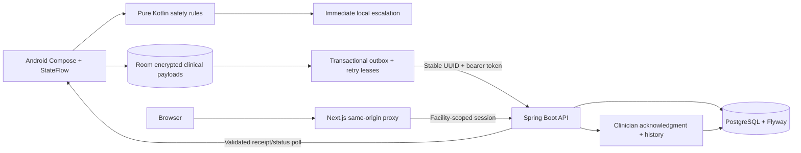

# Architecture

## Components and boundaries

The Android app contains a pure Kotlin `domain` module and an Android `app` module. Compose renders immutable UI state emitted by ViewModel/StateFlow. Clinical rules, validation, referral states, backoff and receipt validation have no Android dependency. Room persists assessments, immutable referral snapshots and outbox metadata transactionally.

The Java21 API uses Spring Boot3.5.16, Spring Security, Bean Validation, JDBC transactions, PostgreSQL and Flyway. Public records are explicit DTOs, never persistence entities. The server recomputes safety flags and urgency. Facility scope derives from authenticated accounts, including administrators; a caller cannot select a broader scope through request parameters.

Next.js supplies the responsive clinical workspace and same-origin backend-for-frontend proxy. Browser sessions use an AES-GCM encrypted HttpOnly/SameSite cookie. The proxy holds the bearer token outside browser JavaScript/localStorage, checks mutation origins, permits only known paths and supplies no-store responses. Operational counts come from scoped stored records.

## Durable synchronization

One transaction commits assessment, immutable referral snapshot and outbox. A UUID/idempotency key remains unchanged through retries. Sending claims an expiring attempt lease; expired attempts return to pending. Failure updates are fenced to the claimed attempt so stale failures cannot overwrite a newer lease. Exponential backoff uses bounded jitter and network constraints. Authentication/validation/conflict errors remain visible and require appropriate user action.

States: DRAFT → PENDING_SYNC → SENT → SERVER_RECEIVED → ACKNOWLEDGED → CLOSED. Failure metadata is separate. SENT means only an attempt. Only a matching validated server response advances delivery; clinician actor/time are required for acknowledgment. Status polling may legitimately observe a later server state after missed updates. The client never regresses confirmed delivery because a later poll fails.

Server transactions serialize identical identifiers, enforce snapshot immutability and return the existing state on identical replay. Conflicting payloads produce409. Acknowledgment/closure transitions lock the row, enforce role/scope and append auditable history. Patient identifiers are synthetic pseudonyms; measurements retain source/time/rule version.

## Encryption and privacy

Room stores every clinical payload, request, receipt and session token as AES-256-GCM ciphertext with fresh nonces and record-specific associated data. Keys are nonexportable Android Keystore keys. Opaque IDs/status/timing metadata remain plaintext for scheduling; schema, record counts and access patterns are not hidden. This is the explicitly documented supported alternative to SQLCipher, not whole-file database encryption. Device backup is disabled; key loss fails closed without silently wiping committed records.

Unsent referrals are not automatically expired. Closed referrals and unlinked assessments have a30-day local retention policy. Explicit deletion warns about undelivered data; it does not delete backend records or guarantee flash-media secure erasure. Server retention/audit disposal require deployment governance.

## AI and clinical safety

Rule version vitalink-rules-1.0.0 is shared by contract. All observed flags are retained even when another flag is urgent; trigger ordering is not significant. Statistical prediction is unavailable and explicitly abstains. Research tooling stays isolated under ml and cannot override emergency rules. The architecture does not establish clinical deployment authorization.
