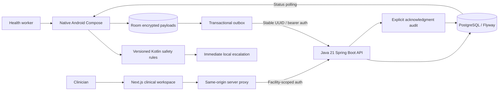

# Technical architecture

Assessment snapshots are immutable. Retry metadata is separate from clinical acknowledgment. Server rules recompute urgency; no client or model priority is trusted. Clinical payload encryption uses Android Keystore AES-GCM; opaque local IDs/status metadata remain queryable. Browser tokens are carried in encrypted HttpOnly session cookies and forwarded by the same-origin proxy, never localStorage.

No predictive model or ONNX artifact is deployed. The rules-only fallback remains functional when inference is unavailable. Real integration and environmental limits are documented in ../docs/FINAL_RELEASE_AUDIT.md.
